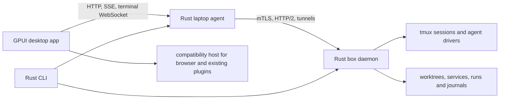

# Rust and GPUI rewrite

This is the execution record for replacing Shipyard's Go services and Tauri/React app with Rust services and a GPUI desktop app while keeping the behavior people use today. The existing implementation remains the reference until each replacement passes its parity gate. Do not switch release packaging to a replacement that has not passed its gate.

## Definition of done

The rewrite is complete only when all of the following are true on macOS, Linux, and Windows where the current product supports them:

1. `berth`, `berthd`, the laptop agent, database and leadline helpers run from Rust binaries without the Go implementations in the release path. Their commands, exit status, output contracts, filesystem formats, socket protocols, API status codes, and error codes match the current release.
2. The GPUI app can carry out every user flow covered by the existing app's unit and Playwright suites against both synthetic fixtures and real local agents. The existing app's 23 built-in themes, 13 built-in plugins, user plugin consent and SDK behavior, browser panes, terminal, editor, and accessibility behavior have parity.
3. Existing agents and boxes can connect across old/new version combinations supported by the current product. Pairing, TLS pinning, revocation, journal recovery, and crash recovery pass compatibility tests using real old and new processes.
4. The installation, update, deep-link, docs, site, and release flows work with the replacement binaries and app. No Go or Tauri runtime is needed by a release. The app core uses GPUI. Existing JavaScript plugins still need a compatible JavaScript and React host until their ABI can change without losing 1:1 behavior.
5. The parity matrix below has direct test or runtime evidence for every row. The project checks in `AGENTS.md`, plus the new Rust workspace checks, pass. The desktop app is inspected in light and dark themes on each supported platform.

Compilation alone does not satisfy these predicates. A missing row or an inconclusive platform check leaves the rewrite incomplete.

## Baseline and scope

The starting commit is `bd4db738`. Inventory commands and sources are in the table. These are rough size measures, not estimates of effort.

| Surface | Baseline | Source |
| --- | ---: | --- |
| Production Go | 380 files, 116,144 lines | `rg --files cmd internal -g '*.go'`, excluding `_test.go`; `wc -l` |
| Go tests | 267 files, 61,228 lines, 1,334 test functions | `rg --files cmd internal -g '*_test.go'`; `rg '^func Test'` |
| App source | 816 TS, TSX, and CSS files, about 144,000 lines | `rg --files app/src -g '*.ts' -g '*.tsx' -g '*.css'` |
| Browser tests | 78 Playwright specs | `rg --files app/e2e -g '*.spec.ts'` |
| API registrations | about 230 explicit box and laptop routes | `rg 'HandleFunc\(' internal/box internal/agent` |
| Plugins and themes | 13 built-in plugins, 23 built-in themes | `plugins/*`, `app/src/themes/builtin.ts`, `app/src/themes/vscode.ts` |

The executable baseline is `go test -race ./...`, the app checks and build, the Tauri `cargo check`, and the existing Playwright specs. Run each on the starting commit and save exit codes before treating later green runs as parity evidence.

## Architecture and boundaries

The app is a client of the laptop agent's authenticated loopback API. `docs/reference/app-api.mdx` and `app/src/lib/api.ts` define the first protocol boundary. Keep that protocol stable while the app and backend are ported independently. The native app must never own box connections or terminate agent sessions when a window closes.

The Rust client library owns URL construction, token handling, response decoding, and error types. Backend domain modules own pairing, session lifecycle, run journals, and worktree state. GPUI views consume typed client events and do not interpret raw API JSON. Each persisted file and wire message must keep a versioned compatibility test before its writer changes.

GPUI has no built-in browser pane. Existing JavaScript plugins are React ES modules. Browser and plugin compatibility therefore require a hosted webview and JavaScript bridge or an equally proven replacement. A native widget with the same name is not parity. Prove child view placement, focus, clipping, and developer tools on every platform before migrating browser and plugin panes. Official GPUI is pre-1.0, so pin an exact revision or version and upgrade it only after a cross-platform check.

## Parity matrix and sequence

Each row is a separately verifiable unit. `open` means no replacement has passed its gate. Units may be developed in parallel only when they own separate files and branches. Integrate into one PR after reviewing the actual diff and evidence.

| Unit | Current owner | Replacement gate | State |
| --- | --- | --- | --- |
| API client and shared wire types | `app/src/lib/api.ts`, `packages/plugin-sdk/src/types.ts`, `docs/reference/app-api.mdx` | Rust client tests against old agent, including auth, errors, SSE, WebSocket, escaping, reconnect | partial: status, SSE, themes, templates, app documents |
| Native shell and layout | `app/src/App.tsx`, workspace and sidebar components | GPUI window, themes, keyboard, pane layout and restore exercised on real builds | partial: fixture window and explicit live status read |
| Browser and plugin host | `app/src-tauri/src/browser.rs`, `app/src/plugins`, `plugins`, plugin SDK | All current plugin contribution types and browser pane behaviors work on every platform | open |
| Terminal and conversations | `app/src/components/workspace`, `app/src/components/conversation` | Same PTY stream, resizing, pace, transcript rendering, send and ask flows | open |
| Files, artifacts and review | `app/src/components/files`, `app/src/components/art`, `app/src/views/pr-review` | Current editing, SQL, artifact and PR review flows pass | open |
| Pages and settings | `app/src/views`, `app/src/lib/prefs.ts` | Onboarding, home, worktrees, automation, team and 14 settings sections pass | open |
| Laptop agent and proxy | `internal/agent`, `internal/proxy`, `internal/network` | Same loopback API, port behavior, reconnect and box proxy semantics pass | open |
| Box API and host lifecycle | `internal/box`, `internal/boxcmd` | Worktrees, sessions, services, runs, browser, artifacts and hooks pass contract tests | open |
| Wire and trust | `internal/wire`, `internal/pairing`, `internal/identity`, `internal/trust` | Old/new pairing, pinning, revocation, local privilege and tunnels pass | open |
| Persistence and recovery | `internal/statefile`, `internal/box/runs` | Existing state read/write and crash recovery pass with mixed versions | partial: statefile crate |
| CLI and helpers | `cmd`, `internal/database`, `internal/leadline`, `internal/integrations` | Command and helper behavior, exit status and outputs match fixtures | open |
| Distribution and web | `install.sh`, `site`, `docs-site`, release scripts | Install, update, links, docs and site build and serve correctly | open |

## Workflow

1. Capture the old behavior and build a compatibility harness. Record API fixtures and CLI output from the old binaries without touching live `~/.berth` state.
2. Land the Rust API client and a runnable GPUI shell. Exercise them against synthetic fixtures and an old agent. These are foundations, not parity claims.
3. Prove browser and plugin hosting on macOS, Linux X11/Wayland, and Windows. If a platform cannot host child views in GPUI, resolve that architecture before porting pane features.
4. Port backend services by ownership boundary. For each service, compare the Rust process with the Go process on the same synthetic inputs. Test mixed-version communication and state recovery at each boundary.
5. Port UI flows against the existing fixture suite, then drive the real app. Capture light and dark screenshots and platform behavior. Keep the legacy implementation as a reference until the replacement passes.
6. Switch packaging only after every matrix row has evidence, run all required checks and a real install/update exercise, then remove legacy runtime code in a separate reviewed unit.

The decision trail for this run is `design/rust-gpui/decisions.tsv`. Each entry points at a source, check, diff or commit that a reviewer can inspect.

## Current evidence

The Rust workspace includes `shipyard-api`, `shipyard-statefile`, and `shipyard-app`. `cargo check --workspace --locked`, `cargo clippy --workspace --all-targets --locked -- -D warnings`, and `cargo test --workspace --locked` pass on macOS. The client has fourteen tests, statefile has eleven, and the GPUI app has four. The GPUI fixture opened as a native window; sidebar navigation and theme switching were exercised in dark and light modes. An explicit loopback endpoint plus `SHIPYARD_API_TOKEN` lets it read box status; a synthetic agent response and a disconnect were exercised in a native window. Status refresh is manual. On this macOS build, accessibility inspection exposed only the window and title, so navigation accessibility remains open.

The old app builds after removing a stale Labs control. Its 548 unit tests and twelve focused browser tests passed, as did the docs build, Go vet, and the Tauri cargo check. The full `go test -race ./...` suite now passes. Its first run failed on `TestAttachPassesShiftEnter` before any Go production code changed: macOS `od` prints two spaces between hex bytes and the test matched one. The test now normalizes whitespace; the isolated test and the full suite pass.
